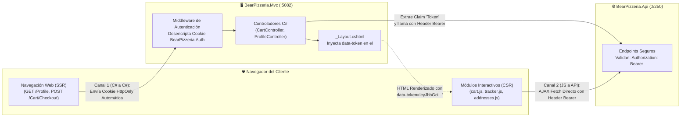

# Arquitectura de Autenticación Híbrida: De JWT Puro a Cookies HttpOnly + JWT

> [!NOTE]
> Este documento registra la decisión arquitectónica y el diseño del sistema de seguridad de **BearPizzeria**: cómo evolucionó desde un modelo tradicional de *solo JWT* hacia un **modelo híbrido de Cookies Seguras (`HttpOnly`) + Tokens JWT**, logrando la máxima comodidad de navegación para el cliente y un estándar riguroso de protección contra vulnerabilidades web (XSS y CSRF).

---

## 1. El Problema de Partida: Las Limitaciones de Usar "Solo JWT"

En las arquitecturas web modernas basadas en APIs desacopladas, el enfoque inicial suele ser emitir un token **JWT (JSON Web Token)** tras el login y confiar su almacenamiento enteramente al navegador del cliente.

Sin embargo, en una aplicación web interactiva que combina vistas renderizadas en servidor (**SSR con Razor**) y scripts asíncronos en el cliente (**CSR con JavaScript ES6**), el esquema de *"solo JWT"* presenta graves inconvenientes:

```
┌────────────────────────────────────────────────────────────────────────┐
│                        ESQUEMA TRADICIONAL "SOLO JWT"                  │
│                                                                        │
│  [API Backend] ──(JWT)──> [Navegador: localStorage / sessionStorage]   │
│                                      │                                 │
│                   ❌ Vulnerable a ataques XSS                          │
│                   ❌ No viaja automáticamente en enlaces <a> ni POSTs   │
│                   ❌ Obliga a recargar datos con JS en cada pantalla    │
└────────────────────────────────────────────────────────────────────────┘
```

1. **Inseguridad frente a Ataques XSS (Cross-Site Scripting):**
   Si el JWT se guarda en el `localStorage` o `sessionStorage` del navegador, cualquier script malicioso inyectado puede leer el token (`localStorage.getItem('token')`) y suplantar la identidad del cliente.
2. **Incompatibilidad con la Navegación Web Tradicional (Enlaces y Redirecciones):**
   Los navegadores web **no adjuntan cabeceras `Authorization: Bearer` automáticamente** cuando el usuario hace clic en un enlace (`<a href="/Profile">`), envía un formulario HTML estándar o recibe una redirección HTTP 302. Esto obligaría a interceptar cada navegación mediante código JavaScript complejo.
3. **Pérdida de Fluidez y Experiencia de Usuario:**
   Sin una sesión nativa, cada refresco de página provocaría un parpadeo en la interfaz mientras un script lee el token y consulta nuevamente al servidor quién es el usuario logueado.

---

## 2. La Solución Adoptada: Arquitectura Híbrida (Cookies + JWT)

Para resolver este dilema sin perder el desacoplamiento de la Minimal API, el grupo diseñó una **arquitectura de doble canal**:

* **Para el Navegador Web (Comodidad y UX):** La sesión del cliente se gestiona mediante una cookie de autenticación cifrada en el servidor: **`BearPizzeria.Auth`**.
* **Para el Backend Minimal API (Desacoplamiento Stateless):** La API no guarda estado de sesión en memoria ni conoce sesiones web; sigue validando peticiones mediante tokens **JWT (`HMAC-SHA256`)**.
* **El Puente de Enlace:** El token JWT emitido por la API se almacena de forma invisible y protegida **dentro de los Claims de la Cookie cifrada**.

---

## 3. Cronología del Login: ¿Qué se genera primero?

**El JWT se genera primero, y la Cookie se genera segundo.**

La razón es causal: la cookie necesita el token JWT para empaquetarlo en su interior. La API es la única autoridad de seguridad que valida el hash de contraseña `PBKDF2-SHA256` y genera el token firmado.

### Diagrama de Secuencia del Inicio de Sesión

```mermaid
sequenceDiagram
    autonumber
    actor Usuario as 👤 Cliente en Navegador
    participant Mvc as 🖥️ BearPizzeria.Mvc (:5082)
    participant Api as ⚙️ BearPizzeria.Api (:5250)
    participant DB as 🗄️ MySQL (5to_Todos)

    Note over Usuario,Mvc: 1. El cliente envía credenciales
    Usuario->>Mvc: POST /Auth/Login { Username, Password }
    Mvc->>Api: POST /api/auth/login { username, password }

    Note over Api,DB: 2. Validación y Generación del JWT
    Api->>DB: SELECT * FROM Usuarios JOIN Clientes WHERE Username = ...
    DB-->>Api: Retorna PasswordHash (PBKDF2) y Salt
    Api->>Api: Verifica PBKDF2 (100.000 iteraciones)
    Api->>Api: 🔑 PASO 1: TokenService genera el JWT firmado (HS256)
    Api-->>Mvc: 200 OK { token: "eyJhbGciOi...", clienteId: 1, ... }

    Note over Mvc: 3. Generación y Cifrado de la Cookie
    Mvc->>Mvc: 🍪 PASO 2: SignInUserAsync() crea ClaimsPrincipal
    Note over Mvc: Empaqueta el JWT en el Claim: "Token"<br/>Cifra la cookie con DataProtection
    Mvc-->>Usuario: HTTP 302 Redirect a "/"<br/>Header: Set-Cookie: BearPizzeria.Auth=...; HttpOnly; SameSite=Lax

    Note over Usuario: 4. El navegador almacena la Cookie segura en su baúl HttpOnly
```

### Detalle del Código en C#

#### Paso 1 — Generación del JWT en `BearPizzeria.Api` (`Program.cs`):
```csharp
// 1. Validar contraseña contra PBKDF2
if (usuario is null || !passwordHasher.VerifyPassword(request.Password, usuario.PasswordHash))
    return Results.BadRequest(new ErrorResponse("AUTH-401", "Usuario o contraseña incorrectos."));

// 2. Generar JWT primero
var token = tokenService.GenerarToken(usuario.Cliente.Id, usuario.Username, usuario.Cliente.Email);

return Results.Ok(new AuthResponse(
    usuario.Cliente.Id,
    usuario.Username,
    usuario.Cliente.Nombre,
    usuario.Cliente.Email,
    usuario.Cliente.Direccion,
    usuario.Cliente.Telefono,
    token // ← JWT retornado al MVC
));
```

#### Paso 2 — Generación de la Cookie en `BearPizzeria.Mvc` (`AuthController.cs`):
```csharp
private async Task SignInUserAsync(AuthResponseDto auth)
{
    var claims = new List<Claim>
    {
        new(ClaimTypes.NameIdentifier, auth.ClienteId.ToString()),
        new(ClaimTypes.Name, auth.Username),
        new(ClaimTypes.Email, auth.Email),
        new("Nombre", auth.Nombre),
        new("Direccion", auth.Direccion),
        new("Telefono", auth.Telefono),
        new("Token", auth.Token) // ← EL JWT QUEDA GUARDADO DENTRO DE LOS CLAIMS DE LA COOKIE
    };

    var identity = new ClaimsIdentity(claims, CookieAuthenticationDefaults.AuthenticationScheme);
    var principal = new ClaimsPrincipal(identity);

    await HttpContext.SignInAsync(
        CookieAuthenticationDefaults.AuthenticationScheme,
        principal,
        new AuthenticationProperties
        {
            IsPersistent = true,
            ExpiresUtc = DateTimeOffset.UtcNow.AddDays(7)
        });
}
```

---

## 4. Convivencia en Simultáneo: El Flujo de Doble Canal

Una vez iniciada la sesión, la Cookie y el JWT operan coordinadamente a través de dos canales especializados:



### Canal 1: Navegación Segura de Servidor a Servidor (C# $\rightarrow$ C#)
* **Cuándo se usa:** Al cargar vistas completas (`/Profile`, `/Cart`, `/Profile/Orders`) o procesar formularios con recarga (`POST /Cart/Checkout`).
* **Mecanismo:**
  1. El navegador envía de forma transparente e inviolable la cookie **`BearPizzeria.Auth`** al servidor MVC.
  2. El middleware `UseAuthentication()` de MVC descifra la cookie y llena `HttpContext.User`.
  3. El controlador MVC toma el claim del token con `User.FindFirst("Token")?.Value` y lo inyecta en el cliente tipado (`HttpClient`), invocando a la API en el puerto `5250` con el encabezado:
     ```http
     Authorization: Bearer eyJhbGciOi...
     ```
* **Beneficio:** El usuario no percibe la presencia de tokens; navega con la naturalidad y rapidez de la web tradicional.

### Canal 2: Peticiones Asíncronas Directas de JavaScript (Navegador $\rightarrow$ API)
* **Cuándo se usa:** Para operaciones en caliente que no deben recargar la pantalla:
  * Agregar pizzas al carrito (`cart.js`).
  * Administrar direcciones en el drawer lateral (`addressDrawer.js`).
  * Monitorear en tiempo real el stepper del pedido activo cada 3 segundos (`tracker.js`).
* **El dilema superado:** ¿Cómo lee JavaScript el token JWT si la cookie tiene el flag de seguridad `HttpOnly = true` (que prohíbe el acceso desde scripts)?
* **La solución en `_Layout.cshtml` (línea 27):**
  Al renderizar el layout base, el servidor MVC imprime el token en un atributo seguro del DOM:
  ```html
  <body data-user-id="@userId" data-token="@(User.FindFirst("Token")?.Value ?? "")">
  ```
  El módulo [`api.js`](file:///mnt/Datos/Repos/PSR-MinimalAPI/src/BearPizzeria.Mvc/wwwroot/js/modules/api.js) lee `document.body.dataset.token` y lo utiliza en sus llamadas `fetch()` directas a `http://localhost:5250`, autorizadas por la política CORS `AllowMvcClient`.

---

## 5. Matriz Comparativa: ¿Por qué esta solución es superior?

| Criterio de Análisis | Enfoque "Solo JWT" (en localStorage) | Enfoque "Solo Cookies" tradicionales | Enfoque Híbrido BearPizzeria (Cookies + JWT) |
| :--- | :---: | :---: | :---: |
| **Protección contra XSS (Robo de sesión)** | ❌ Nula (Cualquier script puede leer `localStorage`) | ✅ Alta (Si usa `HttpOnly`) | ✅ **Máxima:** La sesión raíz viaja protegida en Cookie `HttpOnly`. |
| **Protección contra CSRF** | ✅ Inmune (Si no usa cookies) | ⚠️ Vulnerable si no hay tokens CSRF | ✅ **Completa:** Cookies con `SameSite=Lax` + `ValidateAntiForgeryToken` en formularios. |
| **Navegación fluida por enlaces `<a>`** | ❌ Tediosa (Requiere interceptores JS) | ✅ Nativa y automática | ✅ **Nativa y transparente.** |
| **Soporte para Polling / AJAX en tiempo real** | ✅ Fácil | ⚠️ Sobrecarga al servidor web | ✅ **Excelente:** JavaScript consulta directo a la Minimal API sin triangular por MVC. |
| **Desacoplamiento de la API Backend** | ✅ Totalmente *stateless* | ❌ API acoplada a sesiones | ✅ **Totalmente *stateless*:** La API solo valida JWTs estándar. |

---

## 6. Ciclo de Cierre de Sesión (Logout Seguro)

Cuando el usuario decide cerrar su sesión (`POST /Auth/Logout`):
1. `AuthController` ejecuta:
   ```csharp
   await HttpContext.SignOutAsync(CookieAuthenticationDefaults.AuthenticationScheme);
   ```
2. El servidor responde al navegador con una cabecera de expiración inmediata:
   ```http
   Set-Cookie: BearPizzeria.Auth=; Expires=Thu, 01 Jan 1970 00:00:00 GMT; Path=/; HttpOnly
   ```
3. La cookie se destruye en el navegador, el `<body>` deja de emitir el `data-token` y cualquier intento posterior de consultar rutas protegidas o APIs privadas queda rechazado de inmediato con `401 Unauthorized`.
