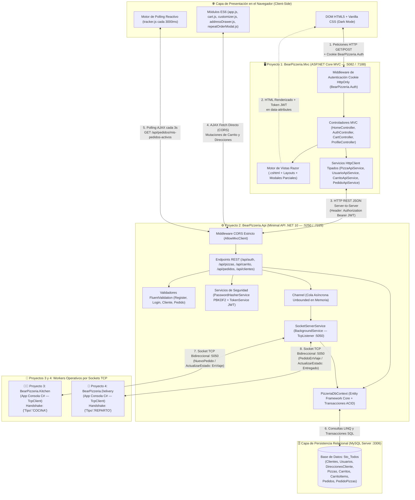
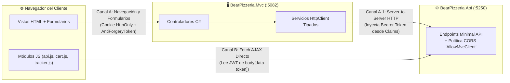
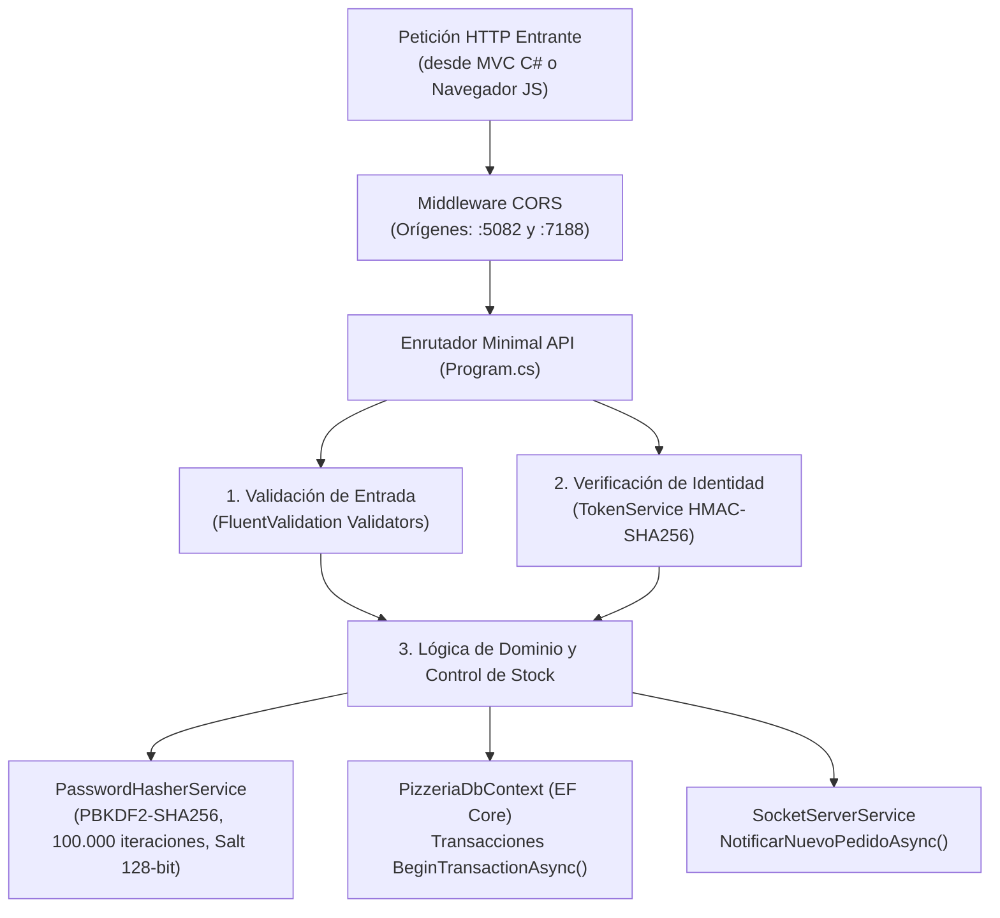
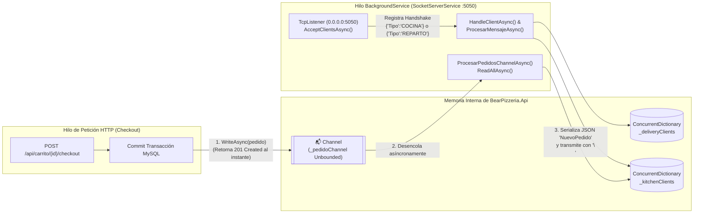
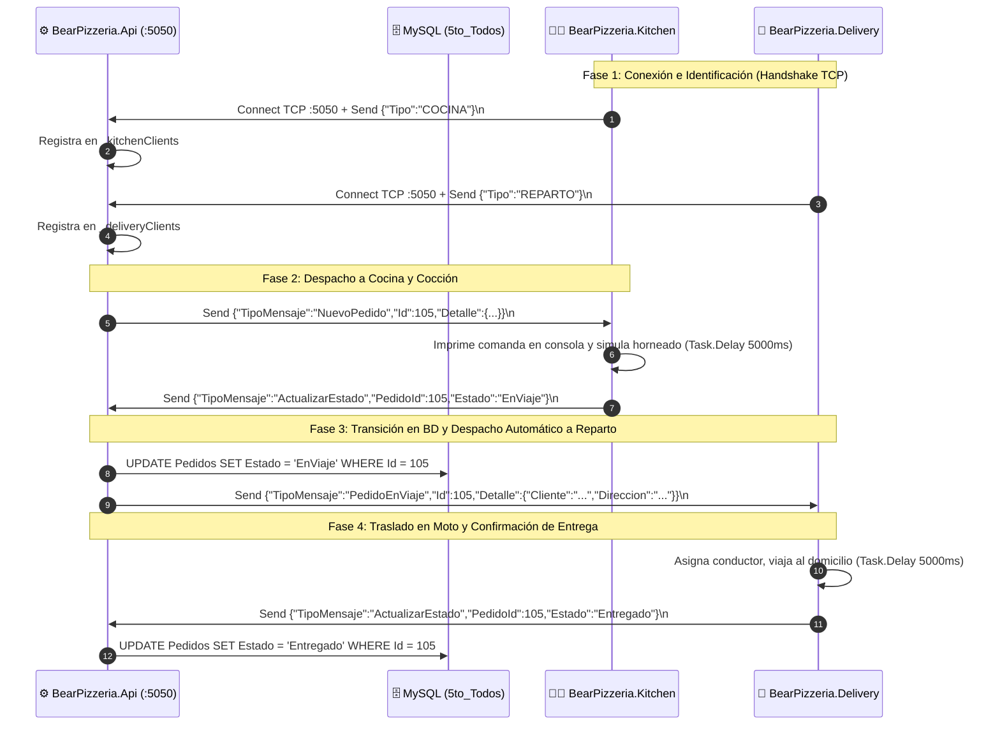
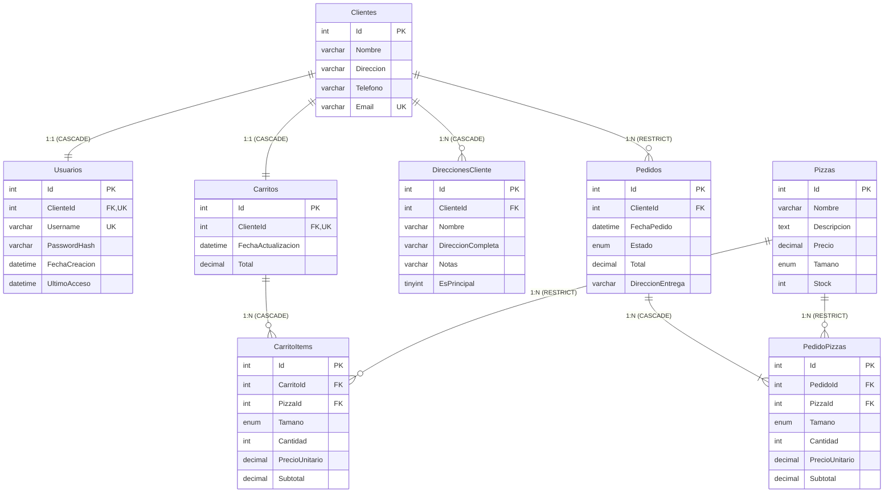

# Diagrama de Arquitectura — BearPizzeria

> [!NOTE]
> Este documento detalla la **arquitectura de software distribuida** de **BearPizzeria**, explicando el propósito interno de cada uno de los **4 proyectos .NET 10** que componen la solución (`BearPizzeria.Mvc`, `BearPizzeria.Api`, `BearPizzeria.Kitchen` y `BearPizzeria.Delivery`), su integración con **MySQL**, los protocolos de transporte híbridos (**HTTP/REST + Cookies/JWT + Sockets TCP NDJSON**) y la desestructuración parte por parte de cada subsistema.

---

## 1. Visión General de la Arquitectura Distribuida

**BearPizzeria** está diseñado bajo una arquitectura **cliente-servidor desacoplada y orientada a eventos en tiempo real**, donde cada proyecto corre como un proceso independiente con responsabilidades claramente delimitadas:

1. **`BearPizzeria.Mvc` (Puerto HTTP `5082` / HTTPS `7188`)**: Aplicación Web Frontend en ASP.NET Core MVC que renderiza la interfaz de usuario mediante vistas Razor (`.cshtml`), administra la sesión del comprador con cookies encriptadas (`BearPizzeria.Auth`) y ejecuta módulos JavaScript ES6 (`cart.js`, `customizer.js`, `tracker.js`, `addressDrawer.js`) en el navegador.
2. **`BearPizzeria.Api` (Puerto HTTP `5250` / HTTPS `7225` + Puerto TCP `5050`)**: Núcleo Backend construido con Minimal APIs en .NET 10. Centraliza las reglas de negocio, el control de stock, la criptografía (`PBKDF2` + `JWT HMAC-SHA256`), el acceso transaccional a datos mediante **Entity Framework Core** y aloja en segundo plano el servidor de sockets TCP (`SocketServerService`).
3. **`BearPizzeria.Kitchen` (Cliente TCP hacia `:5050`)**: Worker de consola independiente que representa la **Cocina Automatizada**. Mantiene un socket TCP abierto con el backend, recibe los pedidos recién confirmados, simula los 5 segundos de horneado y notifica cuando están listos para salir a la calle (`EnViaje`).
4. **`BearPizzeria.Delivery` (Cliente TCP hacia `:5050`)**: Worker de consola independiente que representa el **Reparto Automatizado**. Escucha por socket TCP los pedidos que acaban de salir de cocina (`PedidoEnViaje`), simula los 5 segundos de traslado en moto hasta el domicilio y confirma la entrega final (`Entregado`).
5. **Base de Datos Relacional `MySQL` (`5to_Todos`, Puerto `3306`)**: Motor de persistencia relacional donde residen las 8 tablas del sistema (`Clientes`, `Usuarios`, `DireccionesCliente`, `Pizzas`, `Carritos`, `CarritoItems`, `Pedidos`, `PedidoPizzas`).

---

## 2. Diagrama Maestro de Arquitectura e Interconexión de Proyectos



---

## 3. Desestructuración Parte por Parte de la Arquitectura

A continuación se desarma el diagrama maestro en **5 subsistemas arquitectónicos** para explicar al 100% cómo funciona cada proyecto por dentro y cómo se conecta con los demás.

---

### Parte 1: Comunicación Híbrida entre Navegador, `BearPizzeria.Mvc` y `BearPizzeria.Api`

Una de las características más potentes de **BearPizzeria** es su **arquitectura de comunicación dual** en el frontend (`BearPizzeria.Mvc`): combina el renderizado en servidor (SSR con Razor) con llamadas asíncronas directas desde el navegador (CSR con ES6 Modules).



#### ¿Cómo funcionan ambos canales y por qué coexisten?
1. **Canal A — Comunicación Server-to-Server (Navegador -> MVC `:5082` -> API `:5250`)**:
   * Se utiliza para cargar páginas completas (`GET /`, `GET /Cart`, `GET /Profile`, `GET /Profile/Trackers`, `GET /Profile/Orders`) y procesar envíos de formularios críticos con protección CSRF (`POST /Auth/Login`, `POST /Auth/Register`, `POST /Cart/Checkout`, `POST /Profile/UpdateProfile`).
   * El navegador envía la cookie segura `BearPizzeria.Auth` (`HttpOnly = true`, inaccesible para scripts maliciosos) hacia `BearPizzeria.Mvc`.
   * El controlador MVC desencripta la cookie, extrae el claim `"Token"` y lo reenvía como cabecera `Authorization: Bearer <JWT>` a través de los clientes tipados (`PizzaApiService`, `UsuarioApiService`, `CarritoApiService`, `PedidoApiService`) hacia `BearPizzeria.Api`.
2. **Canal B — Comunicación Client-to-API Directa (Módulos JS -> API `:5250`)**:
   * Se utiliza para operaciones instantáneas que **no deben recargar la página**: agregar una pizza personalizada al carrito (`cart.js`), incrementar/decrementar cantidades, administrar direcciones en el drawer lateral (`addressDrawer.js`), repetir pedidos (`repeatOrderModal.js`) y consultar el estado del pedido cada 3 segundos (`tracker.js`).
   * Cuando el usuario inicia sesión, `_Layout.cshtml` expone en las etiquetas `data-user-id` y `data-token` del `<body>` el identificador y el token JWT del cliente. El módulo `api.js` adjunta automáticamente ese `Authorization: Bearer <JWT>` en cada petición `fetch()` hacia `http://localhost:5250`, autorizado por la política CORS `AllowMvcClient`.

---

### Parte 2: Arquitectura Interna de `BearPizzeria.Api` y Seguridad Criptográfica

El proyecto `BearPizzeria.Api` actúa como el cerebro transaccional del sistema. No depende de librerías externas pesadas para autenticación, sino que implementa sus propios servicios criptográficos de alta seguridad y validación.



#### Componentes Internos de `BearPizzeria.Api`:
* **`PasswordHasherService`**: Al registrar o autenticar un usuario, nunca almacena contraseñas en texto plano. Genera un `Salt` aleatorio de 16 bytes (128 bits) con `RandomNumberGenerator` y deriva una clave de 32 bytes (256 bits) aplicando `Rfc2898DeriveBytes.Pbkdf2` con **100.000 iteraciones** bajo `SHA256`. Durante el login, compara los hashes usando `CryptographicOperations.FixedTimeEquals` para prevenir ataques de temporización (*Timing Attacks*).
* **`TokenService`**: Construye y valida tokens **JWT (`HS256`)** con expiración de 7 días que contienen los claims `sub`, `clienteId`, `username` y `email`. Cada endpoint privado (`/api/carrito/*`, `/api/pedidos/mis-pedidos-activos`, `/api/clientes/{id}`) verifica que el `clienteId` firmado dentro del token coincida con el recurso solicitado, impidiendo que un cliente consulte o modifique el carrito o pedidos de otro.
* **Transacciones ACID en `PizzeriaDbContext`**: En operaciones compuestas como el **Registro** (crea `Cliente` + `Usuario` + `Carrito`) y el **Checkout** (verifica y descuenta `Stock` de cada `Pizza`, resuelve `DireccionEntrega`, crea `Pedido` + `PedidoPizzas` y limpia `CarritoItems`), `BearPizzeria.Api` utiliza `await db.Database.BeginTransactionAsync()`. Si cualquier paso falla (por ejemplo, si una de las 3 pizzas del carrito no tiene stock suficiente), ejecuta `RollbackAsync()` dejando la base de datos intacta.

---

### Parte 3: Arquitectura del Servidor de Sockets TCP (`SocketServerService`) y Cola Asíncrona

Para comunicar el backend HTTP con los módulos de **Cocina** y **Reparto** sin bloquear la respuesta HTTP del cliente que acaba de confirmar su compra, `BearPizzeria.Api` implementa un patrón **Productor-Consumidor en memoria** mediante `System.Threading.Channels.Channel<Pedido>` conectado a un `BackgroundService` de sockets TCP en el puerto `5050`.



#### Cómo funciona internamente `SocketServerService`:
1. **Inicio del Servidor (`ExecuteAsync`)**: Al arrancar `BearPizzeria.Api`, `SocketServerService` levanta un `TcpListener` escuchando en `IPAddress.Any` sobre el puerto `5050` e inicia dos bucles concurrentes: `AcceptClientsAsync` (para aceptar conexiones TCP entrantes) y `ProcesarPedidosChannelAsync` (para despachar pedidos de la cola).
2. **Protocolo de Delimitación por Salto de Línea (`NDJSON` — Newline Delimited JSON)**:
   * Dado que TCP es un protocolo orientado a flujo de bytes (*stream*) donde los mensajes pueden fragmentarse o agruparse en el buffer de red (`byte[4096]`), todos los mensajes entre `BearPizzeria.Api`, `BearPizzeria.Kitchen` y `BearPizzeria.Delivery` se serializan en JSON y **se terminan con un carácter `\n`**.
   * El receptor acumula los bytes leídos en un `StringBuilder` y extrae línea por línea cada vez que detecta `\n`, garantizando que jamás se procese un JSON truncado.
3. **Handshake de Identificación de Rol**:
   * Apenas se conecta `BearPizzeria.Kitchen`, envía `{"Tipo":"COCINA"}\n` y el servidor la registra en `_kitchenClients`.
   * Apenas se conecta `BearPizzeria.Delivery`, envía `{"Tipo":"REPARTO"}\n` y el servidor la registra en `_deliveryClients`.
4. **Limpieza Automática de Desconexiones (`RemoverCliente`)**:
   * Si una consola de Cocina o Reparto se cierra o pierde red, `SocketServerService` captura el cierre del stream y remueve inmediatamente el `TcpClient` del `ConcurrentDictionary` correspondiente. Por su parte, tanto `Kitchen` como `Delivery` poseen un bucle infinito `while (true)` con reintento automático cada **5 segundos** (`await Task.Delay(5000)`).

---

### Parte 4: Funcionamiento Interno de `BearPizzeria.Kitchen` y `BearPizzeria.Delivery`

Los proyectos `BearPizzeria.Kitchen` y `BearPizzeria.Delivery` son aplicaciones de consola en C# (`.NET 10`) diseñadas como demonios operativos autónomos.



#### Contratos Exactos de Mensajes TCP (JSON):

1. **Identificación Inicial (Cliente TCP -> API)**:
   ```json
   {"Tipo": "COCINA"}
   {"Tipo": "REPARTO"}
   ```
2. **Orden de Preparación (API -> Cocina)**:
   ```json
   {
     "TipoMensaje": "NuevoPedido",
     "Id": 105,
     "Detalle": {
       "Cliente": "Martín Gómez",
       "Direccion": "Mi casa: Av. Libertador 1234",
       "Items": [
         {
           "Pizza": "Muzzarella",
           "Tamano": "Grande",
           "Cantidad": 2,
           "PrecioUnitario": 4500.00,
           "Subtotal": 9000.00
         }
       ],
       "Total": 9000.00
     }
   }
   ```
3. **Notificación de Cambio de Estado (Cocina / Reparto -> API)**:
   ```json
   {"TipoMensaje": "ActualizarEstado", "PedidoId": 105, "Estado": "EnViaje"}
   {"TipoMensaje": "ActualizarEstado", "PedidoId": 105, "Estado": "Entregado"}
   ```
4. **Orden de Despacho a Domicilio (API -> Reparto)**:
   ```json
   {
     "TipoMensaje": "PedidoEnViaje",
     "Id": 105,
     "Detalle": {
       "Cliente": "Martín Gómez",
       "Direccion": "Mi casa: Av. Libertador 1234"
     }
   }
   ```

---

### Parte 5: Modelo de Persistencia y Diagrama Entidad-Relación en `MySQL`

Todas las operaciones de los proyectos convergen en la base de datos relacional `5to_Todos` en MySQL, cuyo esquema es garantizado al inicio por `script.sql` y verificado en caliente por `EnsureDatabaseSchemaAsync` en `BearPizzeria.Api/Program.cs`:



---

## 4. Resumen de Puertos, Protocolos y Proyectos de la Solución

| Proyecto (`.csproj`) | Tipo de Ejecutable | Puerto / Dirección | Protocolo | Rol dentro del Recorrido del Pedido |
| :--- | :--- | :--- | :--- | :--- |
| **`BearPizzeria.Mvc`** | Web App (`Microsoft.NET.Sdk.Web`) | `http://localhost:5082`<br>`https://localhost:7188` | HTTP/1.1 & HTTPS | Renderiza catálogo, formularios de login/registro, carrito, selector de direcciones y monitor en vivo (`tracker.js`). |
| **`BearPizzeria.Api`** | Web API (`Microsoft.NET.Sdk.Web`) | `http://localhost:5250`<br>`https://localhost:7225`<br>+ `TCP 0.0.0.0:5050` | HTTP REST JSON<br>+ Sockets TCP | Valida datos, encripta claves, firma JWT, administra el carrito y stock en MySQL y coordina los sockets TCP con Cocina y Reparto. |
| **`BearPizzeria.Kitchen`** | App Consola (`Microsoft.NET.Sdk`) | Conecta a `localhost:5050` | Socket TCP (`NDJSON`) | Recibe nuevos pedidos en estado `EnPreparacion`, simula los 5s de cocción y los promueve a `EnViaje`. |
| **`BearPizzeria.Delivery`** | App Consola (`Microsoft.NET.Sdk`) | Conecta a `localhost:5050` | Socket TCP (`NDJSON`) | Recibe pedidos en estado `EnViaje`, simula los 5s de viaje al domicilio del cliente y los promueve a `Entregado`. |
| **`MySQL Server`** | Motor de Base de Datos Relacional | `localhost:3306`<br>(BD: `5to_Todos`) | MySQL Wire Protocol | Persiste usuarios, direcciones, catálogo con stock, carritos activos e historial de pedidos. |

