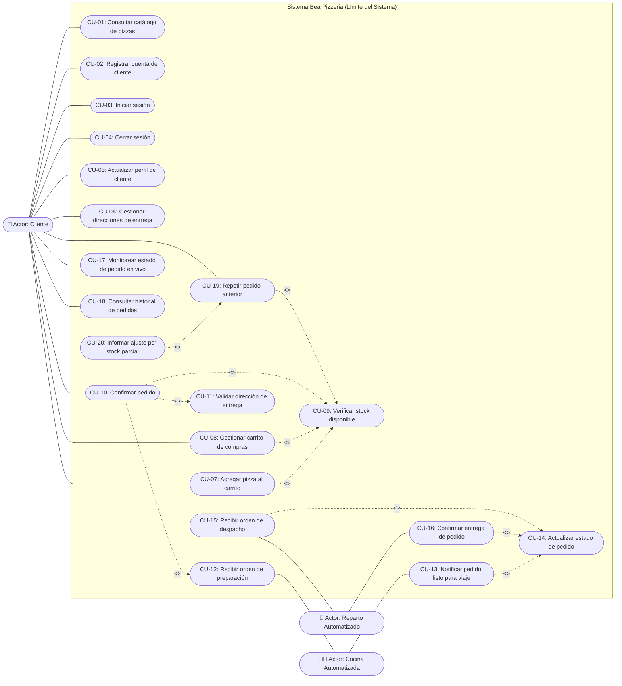
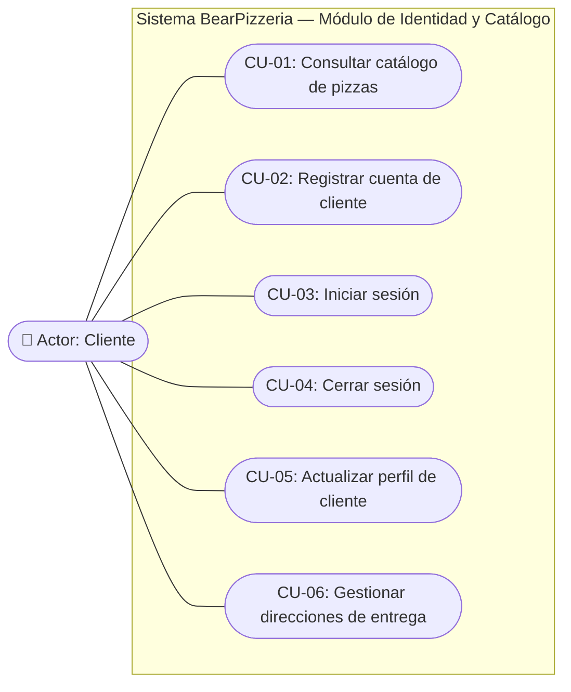
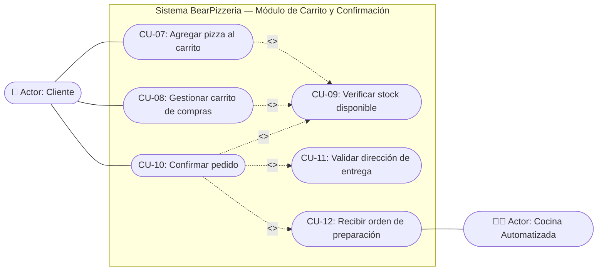
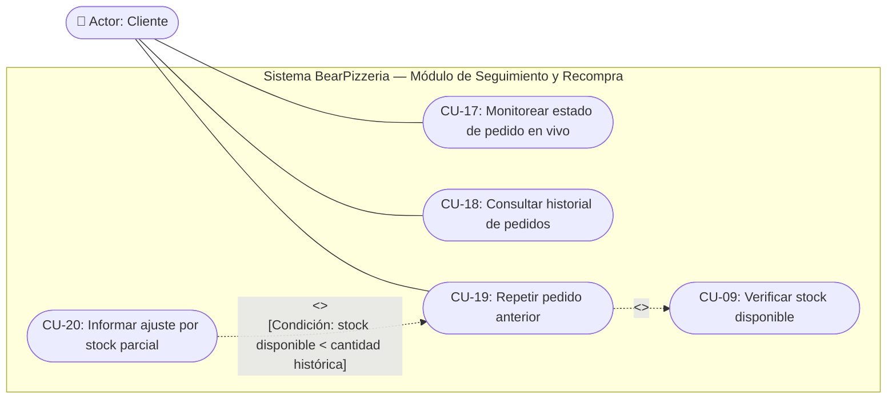
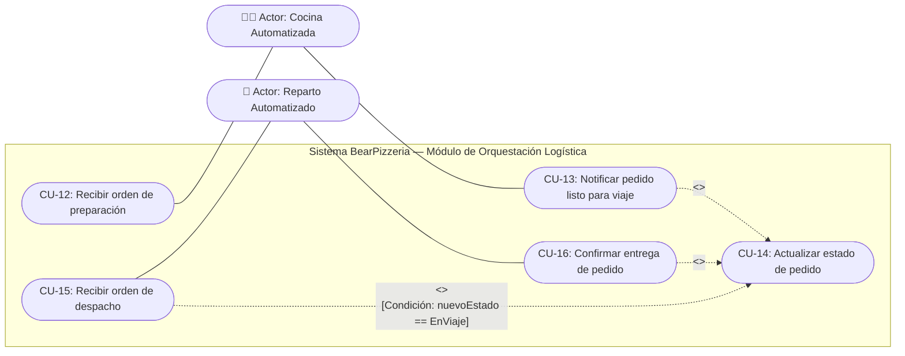

# Diagrama de Casos de Uso — BearPizzeria

> [!NOTE]
> Este documento aplica la metodología de análisis y modelado de **Desarrollo de Sistemas (UML)**: partiendo del **relevamiento del problema**, se identifican los **actores**, se formalizan los **requerimientos funcionales**, se construyen los **casos de uso (Verbo + Objeto)** dentro del **límite del sistema** y se desestructura el diagrama paso a paso justificando cada asociación, `<<include>>`, `<<extend>>` y su **trazabilidad** hacia el diseño.

---

## 1. Del Relevamiento al Modelado Funcional

### 1.1. Problemática Relevada
La pizzería **BearPizzeria** necesita un sistema integral que gestione el recorrido completo de un pedido de pizza desde que el cliente explora el menú hasta que recibe el pedido en su domicilio.

Durante el relevamiento se identificó el siguiente circuito operativo:
1. Un **cliente** ingresa a la plataforma web para consultar el catálogo de pizzas disponibles junto con sus ingredientes, precios base y nivel de stock en tiempo real.
2. Para poder armar su carrito y comprar, el cliente debe **registrar una cuenta** o **iniciar sesión**. Al registrarse, el sistema le asigna automáticamente un carrito de compras persistido en la base de datos para que nunca pierda su selección.
3. El cliente puede **personalizar y agregar pizzas al carrito** eligiendo el tamaño (*Personal*, *Mediana*, *Grande* o *Familiar*) y la cantidad de unidades, así como **modificar cantidades**, **eliminar ítems** o **vaciar el carrito**. Siempre que se agregan unidades o se confirma una compra, el sistema debe **verificar obligatoriamente que exista stock disponible**.
4. El cliente administra una agenda de **direcciones de entrega** (pudiendo agregar nuevas, editarlas, eliminarlas o marcar una como principal). Si el cliente consulta sus direcciones por primera vez y solo posee la dirección base de su registro, el sistema genera automáticamente su dirección principal.
5. Al **confirmar el pedido (Checkout)**, el sistema valida el stock y la dirección de entrega seleccionada, descuenta el stock, genera el pedido en estado inicial `EnPreparacion`, vacía el carrito y **despacha automáticamente la orden a la Cocina Automatizada** mediante una conexión persistente de sockets TCP.
6. La **Cocina Automatizada** recibe el pedido, elabora las pizzas y, al finalizar la cocción, **notifica al sistema que el pedido está listo para el viaje** (`EnViaje`).
7. Cuando el estado pasa a `EnViaje`, el sistema **despacha automáticamente la orden al módulo de Reparto Automatizado**.
8. El **Reparto Automatizado** recibe los datos del cliente y su domicilio, realiza el traslado y al llegar **confirma la entrega del pedido** (`Entregado`).
9. Mientras todo esto ocurre, el cliente puede **monitorear el estado de sus pedidos activos en vivo** mediante una barra de progreso reactiva (`En Preparación` -> `En Camino` -> `Entregado`), **consultar su historial de pedidos** filtrando por fecha y **repetir un pedido anterior** con un solo clic (si alguna pizza del pedido histórico tiene stock insuficiente, el sistema agrega únicamente el remanente disponible y le advierte la situación).

---

## 2. Identificación de Actores (Roles Externos)

Siguiendo las reglas de modelado UML, un **actor** no representa a una persona física concreta (como *"Juan Pérez"*), sino el **rol externo** que desempeña al interactuar con el sistema, ya sea un usuario humano o un sistema/aplicación externa que intercambia información con el núcleo de software:

| Actor | Tipo de Actor | Rol frente al Sistema BearPizzeria | Canal de Interacción |
| :--- | :--- | :--- | :--- |
| **Cliente** | Humano (Primario) | Rol que explora el catálogo, gestiona su cuenta, administra su carrito y direcciones, confirma pedidos, repite compras históricas y monitorea el estado de entrega en tiempo real. | Interfaz Web (`BearPizzeria.Mvc` / Navegador HTTP) |
| **Cocina Automatizada** | Sistema Externo / Dispositivo Operativo | Rol operativo externo (`BearPizzeria.Kitchen`) que recibe las órdenes recién confirmadas, ejecuta el proceso de horneado y reporta al sistema cuando el pedido sale hacia reparto. | Socket TCP (`Puerto 5050`) |
| **Reparto Automatizado** | Sistema Externo / Logística | Rol operativo externo (`BearPizzeria.Delivery`) que recibe las órdenes listas para entregar con su dirección de destino, ejecuta el traslado y reporta la entrega final en domicilio. | Socket TCP (`Puerto 5050`) |

> [!IMPORTANT]
> **¿Por qué el Backend o la Base de Datos NO son actores?**
> En UML, el Backend (`BearPizzeria.Api`), el Frontend (`BearPizzeria.Mvc`) y la Base de Datos (`MySQL`) forman parte del **interior del límite del sistema** que estamos modelando. Los actores se ubican **fuera del rectángulo del sistema** porque representan quiénes utilizan el sistema o intercambian mensajes con él desde el exterior.

---

## 3. Requerimientos Funcionales y Conversión a Casos de Uso

Todo Caso de Uso debe nacer de un Requerimiento Funcional verificable y nombrarse utilizando la estructura **Verbo + Objeto** para expresar un objetivo con valor real para el actor:

| Código RF | Requerimiento Funcional Relevado | Caso de Uso Asociado (Verbo + Objeto) | Actor Participante |
| :--- | :--- | :--- | :--- |
| **RF-01** | El sistema deberá permitir al cliente consultar el catálogo de pizzas con sus precios y stock. | **CU-01: Consultar catálogo de pizzas** | Cliente |
| **RF-02** | El sistema deberá permitir a un nuevo cliente registrar una cuenta personal e inicializar su carrito. | **CU-02: Registrar cuenta de cliente** | Cliente |
| **RF-03** | El sistema deberá permitir al cliente autenticarse mediante usuario y contraseña. | **CU-03: Iniciar sesión** | Cliente |
| **RF-04** | El sistema deberá permitir al cliente cerrar su sesión activa de forma segura. | **CU-04: Cerrar sesión** | Cliente |
| **RF-05** | El sistema deberá permitir al cliente actualizar sus datos personales y de contacto. | **CU-05: Actualizar perfil de cliente** | Cliente |
| **RF-06** | El sistema deberá permitir al cliente administrar sus direcciones de entrega (crear, editar, eliminar y fijar principal). | **CU-06: Gestionar direcciones de entrega** | Cliente |
| **RF-07** | El sistema deberá permitir al cliente seleccionar tamaño y cantidad de una pizza para añadirla a su carrito. | **CU-07: Agregar pizza al carrito** | Cliente |
| **RF-08** | El sistema deberá permitir al cliente consultar su carrito, modificar cantidades, quitar ítems o vaciarlo. | **CU-08: Gestionar carrito de compras** | Cliente |
| **RF-09** | El sistema deberá verificar obligatoriamente el stock disponible antes de agregar pizzas al carrito o confirmar un pedido. | **CU-09: Verificar stock disponible** | *(Incluido internamente)* |
| **RF-10** | El sistema deberá permitir al cliente confirmar la compra de su carrito generando un pedido firme. | **CU-10: Confirmar pedido** | Cliente |
| **RF-11** | El sistema deberá validar que exista una dirección de entrega válida al confirmar un pedido. | **CU-11: Validar dirección de entrega** | *(Incluido internamente)* |
| **RF-12** | El sistema deberá despachar automáticamente cada nuevo pedido confirmado hacia la Cocina Automatizada. | **CU-12: Recibir orden de preparación** | Cocina Automatizada |
| **RF-13** | El sistema deberá permitir a la Cocina Automatizada informar que un pedido finalizó su cocción y pasa a viaje. | **CU-13: Notificar pedido listo para viaje** | Cocina Automatizada |
| **RF-14** | El sistema deberá actualizar el estado del pedido ante las notificaciones operativas de cocina y reparto. | **CU-14: Actualizar estado de pedido** | *(Incluido internamente)* |
| **RF-15** | El sistema deberá despachar automáticamente el pedido al Reparto Automatizado cuando su estado cambie a `EnViaje`. | **CU-15: Recibir orden de despacho** | Reparto Automatizado |
| **RF-16** | El sistema deberá permitir al Reparto Automatizado informar que el pedido fue entregado en el domicilio. | **CU-16: Confirmar entrega de pedido** | Reparto Automatizado |
| **RF-17** | El sistema deberá permitir al cliente monitorear en tiempo real el progreso de sus pedidos activos. | **CU-17: Monitorear estado de pedido en vivo** | Cliente |
| **RF-18** | El sistema deberá permitir al cliente consultar su historial de pedidos paginado y filtrado por fecha. | **CU-18: Consultar historial de pedidos** | Cliente |
| **RF-19** | El sistema deberá permitir al cliente repetir un pedido histórico volcando sus ítems al carrito actual. | **CU-19: Repetir pedido anterior** | Cliente |
| **RF-20** | El sistema deberá informar al cliente cuando un pedido repetido se agregue parcialmente por falta de stock. | **CU-20: Informar ajuste por stock parcial** | *(Extensión condicional)* |

---

## 4. Diagrama General de Casos de Uso

El siguiente diagrama representa la totalidad del **Sistema BearPizzeria**, ubicando a los tres actores fuera del límite del sistema y vinculando los casos de uso mediante asociaciones directas, relaciones obligatorias `<<include>>` y extensiones condicionales `<<extend>>`:

---

## 5. Desestructuración Parte por Parte del Diagrama

Para comprender al 100% cómo funciona el modelo funcional sin ambigüedades, desglosamos el Diagrama General en **cuatro subsistemas funcionales**:

---

### Parte 1: Exploración del Catálogo, Identidad y Perfil del Cliente

Este primer bloque modela cómo el **Cliente** conoce los productos de la pizzería y administra su identidad y domicilios dentro del sistema.

#### Análisis detallado de la Parte 1:
1. **CU-01 (Consultar catálogo de pizzas)**: Es el punto de entrada público. No requiere sesión iniciada y permite observar todas las variedades, precios base e indicadores semafóricos de stock.
2. **CU-02 (Registrar cuenta de cliente) y CU-03 (Iniciar sesión)**: Permiten establecer la identidad del cliente. En `CU-02`, el sistema ejecuta una transacción atómica que crea el `Cliente`, el `Usuario` (con hash `PBKDF2`) y su `Carrito` vacío inicial, iniciando sesión automáticamente.
3. **CU-05 (Actualizar perfil de cliente) y CU-06 (Gestionar direcciones de entrega)**: Permiten mantener actualizados los datos de contacto y administrar múltiples domicilios (*"Mi casa"*, *"Trabajo"*, etc.), garantizando que siempre exista una única dirección marcada como `EsPrincipal = true`.

---

### Parte 2: Carrito de Compras, Checkout y Reglas Obligatorias (`<<include>>`)

Este bloque modela el núcleo transaccional donde el cliente arma su pedido y lo confirma. Aquí cobra vital importancia la relación **`<<include>>`**, que en UML representa un comportamiento obligatorio y reutilizado sin el cual el caso base no puede completarse válidamente.

#### ¿Por qué se utilizan relaciones `<<include>>` en esta parte?
En los apuntes de cátedra se establece la regla: *"La relación `<<include>>` se utiliza cuando un caso de uso incorpora obligatoriamente el comportamiento de otro caso o cuando un comportamiento común se reutiliza desde diferentes casos. La flecha apunta hacia la funcionalidad que está siendo incluida"*.

* **`CU-09: Verificar stock disponible` es incluido por `CU-07`, `CU-08` y `CU-10`**:
  * Cuando el cliente agrega una pizza (`CU-07`) o incrementa su cantidad en el carrito (`CU-08`), el sistema **siempre** comprueba que `cantidadSolicitada <= pizza.Stock`.
  * Cuando el cliente confirma el pedido (`CU-10`), el sistema vuelve a ejecutar `CU-09` dentro de una transacción de base de datos antes de descontar el stock real, evitando ventas sin stock por concurrencia.
* **`CU-11: Validar dirección de entrega` es incluido por `CU-10`**:
  * Ningún pedido puede confirmarse sin una dirección física válida. `CU-10` incluye obligatoriamente la resolución del domicilio (priorizando `DireccionId` seleccionada -> `DireccionEntrega` explícita -> dirección `EsPrincipal` -> dirección base del cliente).
* **`CU-12: Recibir orden de preparación` es incluido por `CU-10`**:
  * Al confirmarse el pedido en base de datos, forma parte obligatoria del proceso encolar el pedido en el canal de sockets TCP para que la **Cocina Automatizada** reciba la orden de inmediato.

---

### Parte 3: Seguimiento en Tiempo Real, Historial y Repetición Condicional (`<<extend>>`)

Este bloque modela las funcionalidades post-compra del cliente: el monitoreo en vivo de la preparación/entrega y la reutilización de pedidos históricos.

#### ¿Por qué `CU-20` utiliza `<<extend>>` sobre `CU-19`?
Según el material de lectura UML: *"La relación `<<extend>>` representa un comportamiento adicional que ocurre solamente bajo determinadas condiciones. El caso principal puede completarse sin que la extensión ocurra en todos los casos. La flecha apunta hacia el caso principal al que extiende"*.

* **Caso Principal (`CU-19: Repetir pedido anterior`)**: El cliente elige un pedido de su historial y solicita repetirlo. Si todas las pizzas tienen stock suficiente, se vuelcan íntegras al carrito y el caso finaliza normalmente.
* **Caso Extendido (`CU-20: Informar ajuste por stock parcial`)**:
  * **Condición de extensión**: *Al menos una pizza del pedido histórico posee un stock actual menor a la cantidad originalmente pedida (`stockDisponibleNeto < cantidadSolicitada`)*.
  * Solo cuando se cumple esta condición, se dispara el comportamiento extendido que agrega únicamente las unidades disponibles y construye el detalle `itemsSinStockSuficiente` para mostrar el modal de advertencia al usuario.

---

### Parte 4: Orquestación Operativa con Cocina y Reparto (Sockets TCP)

Este bloque modela cómo los actores externos **Cocina Automatizada** y **Reparto Automatizado** interactúan con el sistema para hacer avanzar el ciclo de vida del pedido (`EnPreparacion` -> `EnViaje` -> `Entregado`).

#### Análisis de las relaciones en la Parte 4:
1. **Asociación `Cocina Automatizada` — `CU-12` y `CU-13`**: La cocina recibe la orden recién creada (`CU-12`) y, tras simular los 5 segundos de horneado, inicia la acción `CU-13: Notificar pedido listo para viaje`.
2. **Relación `<<include>>` hacia `CU-14: Actualizar estado de pedido`**: Tanto cuando la cocina notifica que terminó (`CU-13`) como cuando el repartidor confirma que entregó la pizza (`CU-16`), el sistema incluye obligatoriamente la persistencia del cambio de estado en la base de datos (`CU-14`).
3. **Relación `<<extend>>` desde `CU-15: Recibir orden de despacho` hacia `CU-14`**:
   * **Condición de extensión**: *El nuevo estado registrado en `CU-14` es exactamente `EnViaje`*.
   * Cuando `CU-14` actualiza el pedido a `EnViaje`, se activa condicionalmente `CU-15` para despachar el mensaje `PedidoEnViaje` por socket TCP al **Reparto Automatizado**. En cambio, cuando `CU-14` actualiza el pedido a `Entregado`, `CU-15` no se ejecuta.

---

## 6. Especificación Detallada de Casos de Uso Principales

A continuación se documentan las fichas técnicas de los casos de uso centrales del recorrido del pedido:

### CU-02: Registrar cuenta de cliente
| Atributo | Especificación |
| :--- | :--- |
| **Actor Principal** | Cliente |
| **Objetivo** | Dar de alta un nuevo cliente con sus credenciales de acceso y crear su carrito persistido en base de datos. |
| **Precondición** | El cliente no posee una sesión activa; el `Username` y el `Email` no están registrados. |
| **Flujo Básico** | 1. El cliente completa nombre, teléfono, email, usuario, contraseña y dirección opcional. 2. El sistema valida el formato de los datos con `RegisterRequestValidator`. 3. El sistema verifica unicidad de `Username` y `Email`. 4. En una transacción atómica, el sistema crea el `Cliente`, genera el hash `PBKDF2` creando el `Usuario` y crea su `Carrito` inicial vacío. 5. El sistema emite el token `JWT` y la cookie `BearPizzeria.Auth`, redirigiendo al catálogo. |
| **Flujos Alternativos** | **2a / 3a. Datos inválidos o duplicados**: El sistema rechaza el alta (`400 Bad Request`) e informa el campo exacto con error en el formulario. |
| **Postcondición** | Cliente, Usuario y Carrito quedan persistidos en MySQL y el cliente queda autenticado. |

### CU-07: Agregar pizza al carrito
| Atributo | Especificación |
| :--- | :--- |
| **Actor Principal** | Cliente |
| **Casos Incluidos** | `<<include>>` **CU-09: Verificar stock disponible** |
| **Precondición** | El cliente ha iniciado sesión y la pizza existe en el catálogo. |
| **Flujo Básico** | 1. El cliente selecciona una pizza, elige su tamaño (`Personal`, `Mediana`, `Grande` o `Familiar`) e indica la cantidad. 2. El sistema ejecuta **CU-09** comprobando que la cantidad acumulada en el carrito no supere el `Stock` actual de la pizza. 3. El sistema calcula el precio unitario aplicando el multiplicador del tamaño (`0.70x`, `0.85x`, `1.00x` o `1.30x`). 4. El sistema inserta o acumula el `CarritoItem` y recalcula el `Total` del `Carrito`. |
| **Flujos Alternativos** | **2a. Stock insuficiente (`STOCK-400`)**: El sistema impide agregar el ítem y retorna un mensaje indicando cuántas unidades tiene en el carrito y cuántas hay disponibles. |
| **Postcondición** | El ítem queda guardado en la tabla `CarritoItems` y el total del carrito queda actualizado. |

### CU-10: Confirmar pedido (Checkout)
| Atributo | Especificación |
| :--- | :--- |
| **Actor Principal** | Cliente |
| **Actor Secundario** | Cocina Automatizada (receptor de `CU-12`) |
| **Casos Incluidos** | `<<include>>` **CU-09: Verificar stock disponible** `<<include>>` **CU-11: Validar dirección de entrega** `<<include>>` **CU-12: Recibir orden de preparación** |
| **Precondición** | El cliente está autenticado y su carrito posee al menos un ítem (`Items.Count > 0`). |
| **Flujo Básico** | 1. El cliente selecciona su dirección de entrega y confirma la compra. 2. El sistema inicia una transacción en base de datos. 3. Ejecuta **CU-09** para cada ítem del carrito y descuenta del campo `Stock` de cada `Pizza` la cantidad comprada. 4. Ejecuta **CU-11** para resolver y fijar la `DireccionEntrega` definitiva del pedido. 5. Crea el registro `Pedido` con estado `EnPreparacion` y vuelca todos los `CarritoItems` hacia `PedidoPizzas`. 6. Vacía los ítems del `Carrito` del cliente y resetea su total a `0.00`, confirmando la transacción. 7. Ejecuta **CU-12** escribiendo el pedido en el canal asíncrono para enviarlo por socket TCP a la Cocina Automatizada. 8. Redirige al cliente a su perfil con el monitor en vivo activado. |
| **Flujos Alternativos** | **3a. Stock agotado antes del checkout**: Se hace `Rollback` de la transacción y se informa qué pizza quedó sin stock suficiente. **4a. Sin dirección de entrega**: Se hace `Rollback` y se solicita ingresar o elegir un domicilio. |
| **Postcondición** | El pedido queda registrado en estado `EnPreparacion`, el stock descontado, el carrito vacío y la cocina notificada por TCP. |

### CU-13 y CU-16: Notificar pedido listo para viaje / Confirmar entrega de pedido
| Atributo | Especificación |
| :--- | :--- |
| **Actores** | Cocina Automatizada (`CU-13`) / Reparto Automatizado (`CU-16`) |
| **Casos Incluidos / Extendidos** | `<<include>>` **CU-14: Actualizar estado de pedido** `<<extend>>` **CU-15: Recibir orden de despacho** *(solo cuando el nuevo estado es `EnViaje`)* |
| **Precondición** | El cliente socket (`COCINA` o `REPARTO`) se encuentra conectado y registrado en el puerto TCP `5050`. |
| **Flujo Básico** | 1. Al finalizar su tarea operativa (5s de cocción en cocina o 5s de viaje en reparto), el actor envía por socket TCP la trama JSON `{"TipoMensaje":"ActualizarEstado", "PedidoId": X, "Estado": "..."}`. 2. El sistema ejecuta **CU-14**, localizando el pedido en MySQL y actualizando su columna `Estado`. 3. **Punto de Extensión**: Si el nuevo estado es `EnViaje`, se ejecuta **CU-15** enviando la trama `PedidoEnViaje` a todas las instancias conectadas de **Reparto Automatizado**. |
| **Postcondición** | El estado del pedido avanza en la base de datos y queda inmediatamente visible para el polling del cliente web. |

---

## 7. Matriz de Trazabilidad Completa

Siguiendo la sección **32. Trazabilidad** del material de cátedra (*Necesidad -> Requerimiento -> Caso de Uso -> Clases relacionadas -> Interfaz / Implementación*), la siguiente tabla demuestra la continuidad de punta a punta del sistema:

| Requerimiento | Caso de Uso | Clases del Dominio Involucradas | Interfaz MVC / Vista Razor | Endpoint Minimal API / Canal TCP |
| :--- | :--- | :--- | :--- | :--- |
| **RF-01** | **CU-01**: Consultar catálogo de pizzas | `Pizza`, `TamanoPizza` | `Views/Home/Index.cshtml` `_ProductGrid.cshtml` | `GET /api/pizzas` `GET /api/pizzas/{id}` |
| **RF-02** | **CU-02**: Registrar cuenta de cliente | `Cliente`, `Usuario`, `Carrito` | `Views/Auth/Register.cshtml` | `POST /api/auth/register` |
| **RF-03** | **CU-03**: Iniciar sesión | `Usuario`, `Cliente` | `Views/Auth/Login.cshtml` | `POST /api/auth/login` |
| **RF-05** | **CU-05**: Actualizar perfil de cliente | `Cliente`, `Usuario` | `Views/Profile/Index.cshtml` | `PUT /api/clientes/{id}` |
| **RF-06** | **CU-06**: Gestionar direcciones de entrega | `DireccionCliente`, `Cliente` | `_AddressSidebar.cshtml` `addressDrawer.js` | `GET/POST/PUT/DELETE /api/clientes/{clienteId}/direcciones` |
| **RF-07** **RF-09** | **CU-07**: Agregar pizza al carrito `<<include>>` **CU-09** | `Carrito`, `CarritoItem`, `Pizza`, `TamanoPizza` | `_CustomizerModal.cshtml` `customizer.js`, `cart.js` | `POST /api/carrito/{clienteId}/items` |
| **RF-08** **RF-09** | **CU-08**: Gestionar carrito de compras `<<include>>` **CU-09** | `Carrito`, `CarritoItem`, `Pizza` | `Views/Cart/Index.cshtml` `cart.js` | `GET /api/carrito/{clienteId}` `PUT/DELETE /api/carrito/items/{itemId}` `DELETE /api/carrito/{clienteId}/vaciar` |
| **RF-10** **RF-11** | **CU-10**: Confirmar pedido `<<include>>` **CU-09, CU-11, CU-12** | `Carrito`, `CarritoItem`, `Pedido`, `PedidoPizza`, `Pizza`, `DireccionCliente` | `Views/Cart/Index.cshtml` (`CartController.Checkout`) | `POST /api/carrito/{clienteId}/checkout` |
| **RF-12** **RF-13** | **CU-12**: Recibir orden de preparación **CU-13**: Notificar pedido listo | `Pedido`, `PedidoPizza`, `EstadoPedido`, `SocketServerService` | Consola `BearPizzeria.Kitchen` | Socket TCP `:5050` (`NuevoPedido` / `ActualizarEstado: EnViaje`) |
| **RF-15** **RF-16** | **CU-15**: Recibir orden de despacho **CU-16**: Confirmar entrega | `Pedido`, `Cliente`, `EstadoPedido`, `SocketServerService` | Consola `BearPizzeria.Delivery` | Socket TCP `:5050` (`PedidoEnViaje` / `ActualizarEstado: Entregado`) |
| **RF-17** | **CU-17**: Monitorear estado de pedido en vivo | `Pedido`, `EstadoPedido` | `Views/Profile/Trackers.cshtml` `tracker.js` | `GET /api/pedidos/mis-pedidos-activos` `GET /api/pedidos/mi-pedido-activo` |
| **RF-18** | **CU-18**: Consultar historial de pedidos | `Pedido`, `PedidoPizza`, `Pizza` | `Views/Profile/Orders.cshtml` | `GET /api/pedidos/cliente/{clienteId}` |
| **RF-19** **RF-20** | **CU-19**: Repetir pedido anterior `<<extend>>` **CU-20** | `Pedido`, `PedidoPizza`, `Carrito`, `CarritoItem`, `Pizza` | `Views/Profile/Orders.cshtml` `_RepeatOrderStockModal.cshtml` | `POST /api/pedidos/{id}/repetir` |

