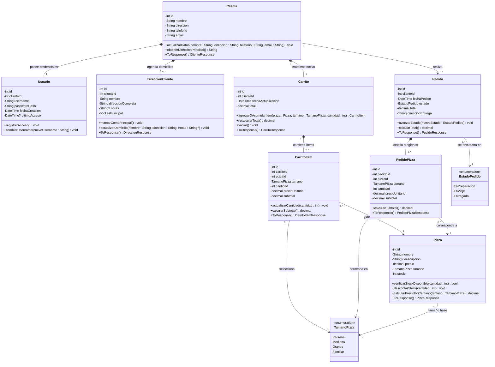
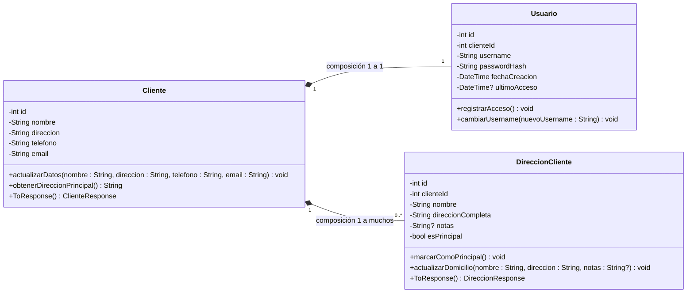
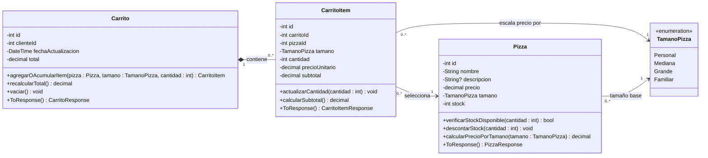
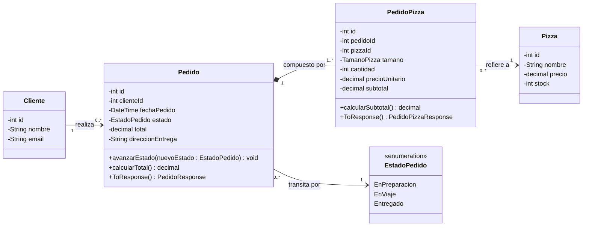
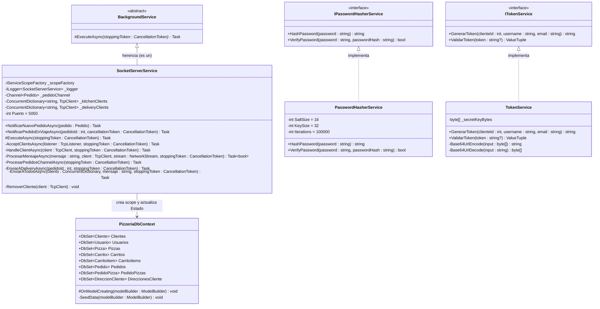

# Diagrama de Clases — BearPizzeria

> [!NOTE]
> Este documento modela la **estructura estática** del ecosistema **BearPizzeria** aplicando rigurosamente los lineamientos de **Desarrollo de Sistemas — Diagrama de Clases UML**: transición desde los Casos de Uso a las clases del dominio, anatomía de tres compartimentos (*Nombre*, *Atributos con tipo y visibilidad*, *Métodos/Responsabilidades*), justificación de clases asociativas (`CarritoItem`, `PedidoPizza`), lectura exacta de **multiplicidades** (`1`, `0..1`, `0..*`, `1..*`), relaciones de **composición/agregación** y desestructuración por subsistemas.

---

## 1. Del Comportamiento (Casos de Uso) a la Estructura (Clases)

Mientras el [Diagrama de Casos de Uso](DiagramaDeCasosDeUso.md) responde **qué hace el sistema y quién lo utiliza**, el **Diagrama de Clases** responde **qué elementos estructurales necesita el sistema para organizar su información y responsabilidades**.

Siguiendo la regla fundamental del análisis orientado a objetos:
* **Un Caso de Uso NO se convierte automáticamente en una clase**: Por ejemplo, el caso de uso `CU-10: Confirmar pedido` no crea una clase llamada `ConfirmarPedido`, sino que se resuelve mediante la colaboración estructural entre `Cliente`, `Carrito`, `CarritoItem`, `Pizza`, `DireccionCliente`, `Pedido` y `PedidoPizza`.
* **No todo sustantivo es una clase**: Conceptos relevantes sobre los cuales el sistema necesita almacenar estado e impartir reglas de negocio se modelan como clases (`Cliente`, `Usuario`, `Pizza`, `Carrito`, `Pedido`), mientras que valores acotados se modelan como enumeraciones (`TamanoPizza`, `EstadoPedido`).

### 1.1. Cuadro de Identificación Inicial del Modelo de Dominio

| Clase / Enumeración | Concepto que Representa | Atributos Principales (`- privado` / `+ público`) | Responsabilidades / Operaciones Principales |
| :--- | :--- | :--- | :--- |
| **`Cliente`** | Datos personales y de contacto del comprador en la pizzería. | `id : int`, `nombre : String`, `direccion : String`, `telefono : String`, `email : String` | `actualizarDatos()`, `obtenerDireccionPrincipal()`, `ToResponse()` |
| **`Usuario`** | Credenciales de seguridad y control de acceso vinculadas 1 a 1 con el cliente. | `id : int`, `clienteId : int`, `username : String`, `passwordHash : String`, `fechaCreacion : DateTime`, `ultimoAcceso : DateTime?` | `registrarAcceso()`, `verificarCredenciales()` |
| **`DireccionCliente`** | Agenda de domicilios de entrega etiquetados (*"Mi casa"*, *"Trabajo"*). | `id : int`, `clienteId : int`, `nombre : String`, `direccionCompleta : String`, `notas : String?`, `esPrincipal : bool` | `marcarComoPrincipal()`, `actualizarDomicilio()`, `ToResponse()` |
| **`Pizza`** | Producto del catálogo con precio base y stock controlable en tiempo real. | `id : int`, `nombre : String`, `descripcion : String?`, `precio : decimal`, `tamano : TamanoPizza`, `stock : int` | `verificarStockDisponible(cantidad : int)`, `descontarStock(cantidad : int)`, `calcularPrecioPorTamano(tamano : TamanoPizza)`, `ToResponse()` |
| **`Carrito`** | Contenedor temporal pero persistido en BD (1:1 con `Cliente`) de la compra en armado. | `id : int`, `clienteId : int`, `fechaActualizacion : DateTime`, `total : decimal` | `agregarItem(pizza : Pizza, tamano : TamanoPizza, cantidad : int)`, `recalcularTotal()`, `vaciar()`, `confirmarCheckout()`, `ToResponse()` |
| **`CarritoItem`** | Línea individual dentro del carrito que vincula una `Pizza` con un `TamanoPizza` y `Cantidad`. | `id : int`, `carritoId : int`, `pizzaId : int`, `tamano : TamanoPizza`, `cantidad : int`, `precioUnitario : decimal`, `subtotal : decimal` | `actualizarCantidad(nuevaCantidad : int)`, `calcularSubtotal()`, `ToResponse()` |
| **`Pedido`** | Orden de compra firme e inmutable que transita por Cocina y Reparto. | `id : int`, `clienteId : int`, `fechaPedido : DateTime`, `estado : EstadoPedido`, `total : decimal`, `direccionEntrega : String` | `avanzarEstado(nuevoEstado : EstadoPedido)`, `calcularTotal()`, `ToResponse()` |
| **`PedidoPizza`** | Detalle histórico de cada pizza comprada en un `Pedido` con su precio congelado. | `id : int`, `pedidoId : int`, `pizzaId : int`, `tamano : TamanoPizza`, `cantidad : int`, `precioUnitario : decimal`, `subtotal : decimal` | `calcularSubtotal()`, `ToResponse()` |
| **`TamanoPizza`** | `<<enumeration>>` Escala de tamaños y porciones de pizza. | `Personal` (0.70x), `Mediana` (0.85x), `Grande` (1.00x), `Familiar` (1.30x) | Escalar precio base según tamaño seleccionado. |
| **`EstadoPedido`** | `<<enumeration>>` Ciclo de vida logístico del pedido. | `EnPreparacion`, `EnViaje`, `Entregado` | Controlar transiciones válidas de Cocina y Reparto. |

---

## 2. Diagrama de Clases Integrado del Dominio (Vista UML Completa)

El siguiente diagrama representa el **Modelo Estructural Completo del Dominio de BearPizzeria**, respetando los tres sectores de cada clase (Nombre, Atributos con visibilidad y tipo, Operaciones/Métodos), las relaciones de composición (`*--`), asociación (`-->`) y las multiplicidades exactas del negocio:

---

## 3. Desestructuración Parte por Parte del Diagrama de Clases

Para comprender al 100% cada decisión de diseño, desglosamos el diagrama general en **cinco bloques estructurales**, analizando sus atributos, encapsulamiento, relaciones y multiplicidades.

---

### Parte 1: Subsistema de Identidad, Perfil y Domicilios (`Cliente`, `Usuario`, `DireccionCliente`)

Este bloque modela quién es el comprador, cómo se autentica de manera segura sin exponer sus credenciales en las consultas de negocio y cómo administra múltiples lugares de entrega.

#### Explicación y Justificación de Diseño (Parte 1):
1. **Separación entre `Cliente` y `Usuario` (Principio de Responsabilidad Única y Encapsulamiento)**:
   * `Cliente` conserva los datos del negocio gastronómico (`nombre`, `direccion`, `telefono`, `email`).
   * `Usuario` encapsula los datos sensibles de seguridad (`username`, `passwordHash` encriptado con `PBKDF2-SHA256`, `fechaCreacion`, `ultimoAcceso`).
   * **Relación y Multiplicidad (`1` a `1` Composición)**: Cada `Cliente` tiene exactamente un `Usuario` asociado, y cada `Usuario` pertenece a un único `Cliente` (`ON DELETE CASCADE`). Si el cliente se elimina, su cuenta de usuario carece de sentido y desaparece con él.
2. **Agenda de Domicilios (`DireccionCliente`)**:
   * Un cliente puede pedir pizzas hoy desde `"Mi casa"` y mañana desde el `"Trabajo"`. Si solo existiera el atributo `direccion : String` dentro de `Cliente`, se perderían las direcciones frecuentes y las notas para el repartidor (*"Timbre B, portón negro"*).
   * **Relación y Multiplicidad (`1` a `0..*` Composición)**: Un `Cliente` puede tener ninguna o muchas (`0..*`) instancias de `DireccionCliente`; cada `DireccionCliente` pertenece exclusivamente a `1` `Cliente`.

---

### Parte 2: Subsistema de Catálogo y Carrito Persistido (`Pizza`, `Carrito`, `CarritoItem`, `TamanoPizza`)

Este bloque modela cómo el sistema representa las variedades de pizzas disponibles y cómo persiste la selección temporal del cliente en la base de datos antes de comprar.

#### ¿Por qué `CarritoItem` es una clase propia y no una simple línea entre `Carrito` y `Pizza`?
Tal como explica el apunte de cátedra en la sección *"8. ¿Por qué Inscripción es una clase?"*:
> *"Relacionar directamente dos clases no permite guardar información propia de la relación. Cuando una relación necesita datos o comportamientos propios, debe representarse mediante una clase intermedia."*

En **BearPizzeria**, si relacionáramos directamente `Carrito` con `Pizza`:
1. No podríamos saber **cuántas unidades** (`cantidad`) de esa pizza quiere el cliente.
2. No podríamos permitir que el mismo carrito tenga **dos pizzas Muzzarella de distinto tamaño** (por ejemplo, `1x Muzzarella Grande` y `1x Muzzarella Personal`), ya que el tamaño elegido (`TamanoPizza`) y el `precioUnitario` calculado con el multiplicador (`0.70x`, `0.85x`, `1.00x`, `1.30x`) son atributos propios del renglón (`CarritoItem`) y no del catálogo general (`Pizza`).

#### Lectura de Multiplicidades (Parte 2):
* **`Cliente` (`1`) `*--` (`1`) `Carrito`**: Cada cliente registrado posee exactamente un carrito persistido en la base de datos.
* **`Carrito` (`1`) `*--` (`0..*`) `CarritoItem`**: Un carrito puede estar vacío (`0`) o contener muchos ítems (`*`). Es una **composición** porque un `CarritoItem` no puede existir fuera de su `Carrito`.
* **`CarritoItem` (`0..*`) `-->` (`1`) `Pizza`**: Cada ítem del carrito apunta obligatoriamente a una `Pizza` del catálogo; una `Pizza` puede estar presente en cero o muchos ítems de carritos de distintos clientes (`ON DELETE RESTRICT` para impedir borrar del catálogo una pizza en uso).

---

### Parte 3: Subsistema de Pedidos y Facturación Histórica (`Pedido`, `PedidoPizza`, `EstadoPedido`)

Cuando el cliente confirma su compra (`Checkout`), los ítems volátiles del `Carrito` se transforman en una orden firme e histórica compuesta por `Pedido` y `PedidoPizza`.

#### ¿Por qué `PedidoPizza` guarda `precioUnitario`, `subtotal` y `Pedido` guarda `direccionEntrega`?
Esta es una decisión crítica de ingeniería de software: **Inmutabilidad Histórica**.
* Si mañana la pizzería aumenta el precio de la *Muzzarella* de `$4500` a `$6000` en la clase `Pizza`, los pedidos que el cliente realizó el mes pasado **no deben cambiar su total histórico**. Por eso `PedidoPizza` congela el `precioUnitario` y el `subtotal` vigentes en el instante exacto del checkout.
* De igual forma, `Pedido` congela en `direccionEntrega : String` el domicilio exacto al que se envió esa orden, independientemente de que el cliente edite o borre esa dirección meses después.

#### Lectura de Multiplicidades (Parte 3):
* **`Cliente` (`1`) `-->` (`0..*`) `Pedido`**: Un cliente recién registrado puede tener `0` pedidos, o haber realizado muchos (`*`) a lo largo del tiempo. Cada `Pedido` pertenece exactamente a `1` `Cliente`.
* **`Pedido` (`1`) `*--` (`1..*`) `PedidoPizza`**: A diferencia del carrito (que puede tener `0` ítems), un `Pedido` confirmado **siempre tiene al menos un renglón (`1..*`)**, ya que el sistema prohíbe hacer checkout de un carrito vacío. Además es una **composición** (`*--`): los renglones `PedidoPizza` son parte indivisible del `Pedido`.
* **`PedidoPizza` (`0..*`) `-->` (`1`) `Pizza`**: Cada renglón del pedido identifica exactamente qué `Pizza` se cocinó; una `Pizza` puede figurar en cero o miles de renglones históricos.

---

### Parte 4: Clases de Infraestructura, Seguridad y Sockets en `BearPizzeria.Api`

Para llevar el modelo de dominio a la implementación real en `.NET 10`, el proyecto backend `BearPizzeria.Api` incorpora clases de persistencia (`PizzeriaDbContext`), seguridad criptográfica (`PasswordHasherService`, `TokenService`), validación (`FluentValidation`) y orquestación por sockets TCP (`SocketServerService` que hereda de `BackgroundService`):

#### Conceptos UML aplicados en la Parte 4:
* **Herencia / Generalización (`<|--`)**: `SocketServerService` hereda de la clase base abstracta `BackgroundService` de .NET (`SocketServerService` *es un* servicio en segundo plano de larga duración que sobrescribe `ExecuteAsync`).
* **Realización de Interfaces (`<|..`)**: `PasswordHasherService` implementa el contrato `IPasswordHasherService` (encapsulando los detalles de `PBKDF2` con 100.000 iteraciones y comparación en tiempo constante `FixedTimeEquals`), y `TokenService` implementa `ITokenService` (encapsulando la firma `HMAC-SHA256` del token JWT).
* **Encapsulamiento Estricto de Concurrencia**: En `SocketServerService`, los diccionarios `_kitchenClients`, `_deliveryClients` y la cola `_pedidoChannel` son privados (`-`). Ningún endpoint externo puede manipular directamente los sockets TCP; solo pueden invocar los métodos públicos (`+`) `NotificarNuevoPedidoAsync` y `NotificarPedidoEnViajeAsync`.

---

### Parte 5: Clases del Frontend Web en `BearPizzeria.Mvc` (Controladores, Servicios Tipados y ViewModels)

El proyecto `BearPizzeria.Mvc` estructura sus clases aplicando el patrón **Model-View-Controller (MVC)** combinado con el patrón **Typed HttpClient Service** para desacoplar las vistas de las llamadas HTTP hacia la API:

```mermaid
classDiagram
    direction TB

    class HomeController {
        -IPizzaApiService _pizzaApiService
        -ILogger~HomeController~ _logger
        +Index() Task~IActionResult~
        +Privacy() IActionResult
    }

    class AuthController {
        -IUsuarioApiService _usuarioApiService
        -ILogger~AuthController~ _logger
        +Login(returnUrl : string?) IActionResult
        +Login(model : LoginViewModel) Task~IActionResult~
        +Register() IActionResult
        +Register(model : RegisterViewModel) Task~IActionResult~
        +Logout() Task~IActionResult~
        -SignInUserAsync(auth : AuthResponseDto) Task
    }

    class CartController {
        -ICarritoApiService _carritoApiService
        -ILogger~CartController~ _logger
        +Index() Task~IActionResult~
        +Checkout(direccionId : int?) Task~IActionResult~
    }

    class ProfileController {
        -IPedidoApiService _pedidoApiService
        -IUsuarioApiService _usuarioApiService
        -ILogger~ProfileController~ _logger
        +Index() Task~IActionResult~
        +Trackers() Task~IActionResult~
        +Orders(page : int, fecha : string?) Task~IActionResult~
        +ActiveOrdersJson() Task~IActionResult~
        +ActiveOrderJson() Task~IActionResult~
        +AllOrdersJson() Task~IActionResult~
        +UpdateProfile(model : EditProfileViewModel) Task~IActionResult~
        -RefreshUserClaimsAsync(clienteUpdated : ClienteDto, token : string) Task
    }

    class IPizzaApiService {
        <<interface>>
        +GetPizzasAsync() Task~List~PizzaDto~~
        +GetPizzaByIdAsync(id : int) Task~PizzaDto?~
    }

    class IUsuarioApiService {
        <<interface>>
        +RegisterAsync(request : RegisterDto) Task~AuthResponseDto?~
        +LoginAsync(request : LoginDto) Task~AuthResponseDto?~
        +GetUserSessionAsync(clienteId : int, token : string?) Task~AuthResponseDto?~
        +UpdateClienteAsync(clienteId : int, request : ActualizarClienteDto, token : string?) Task~ClienteDto?~
    }

    class ICarritoApiService {
        <<interface>>
        +GetCarritoAsync(clienteId : int, token : string?) Task~CarritoDto?~
        +AgregarItemCarritoAsync(clienteId : int, request : AgregarItemCarritoDto, token : string?) Task~CarritoDto?~
        +ActualizarItemCarritoAsync(itemId : int, request : ActualizarItemCarritoDto, token : string?) Task~CarritoDto?~
        +EliminarItemCarritoAsync(itemId : int, token : string?) Task~CarritoDto?~
        +VaciarCarritoAsync(clienteId : int, token : string?) Task~CarritoDto?~
        +CheckoutCarritoAsync(clienteId : int, direccionId : int?, token : string?) Task~PedidoDto?~
    }

    class IPedidoApiService {
        <<interface>>
        +GetPedidoByIdAsync(id : int) Task~PedidoDto?~
        +GetMiPedidoActivoAsync(token : string?) Task~PedidoDto?~
        +GetMisPedidosActivosAsync(token : string?) Task~List~PedidoDto~~
        +GetPedidosByClienteAsync(clienteId : int, token : string?) Task~List~PedidoDto~~
    }

    HomeController --> IPizzaApiService : consume
    AuthController --> IUsuarioApiService : consume
    CartController --> ICarritoApiService : consume
    ProfileController --> IPedidoApiService : consume
    ProfileController --> IUsuarioApiService : consume
```

---

## 4. Tabla Resumen de Relaciones y Multiplicidades del Dominio

Para verificar que el modelo cumple con todas las reglas de validación de la cátedra (*Sección 35.2 Revisión de Clases*), se sintetiza la justificación de cada relación estructural:

| Clase Origen | Multiplicidad Origen | Tipo de Relación UML | Multiplicidad Destino | Clase Destino | Regla de Negocio que la Justifica |
| :--- | :---: | :---: | :---: | :--- | :--- |
| **`Cliente`** | `1` | Composición (`*--`) | `1` | **`Usuario`** | Todo cliente registrado posee una única credencial de acceso; las credenciales no existen sin el cliente. |
| **`Cliente`** | `1` | Composición (`*--`) | `1` | **`Carrito`** | A cada cliente se le asigna un único carrito persistido en BD al registrarse. |
| **`Cliente`** | `1` | Composición (`*--`) | `0..*` | **`DireccionCliente`** | Un cliente puede tener cero o múltiples direcciones agendadas en su libreta de entregas. |
| **`Cliente`** | `1` | Asociación (`-->`) | `0..*` | **`Pedido`** | Un cliente puede haber realizado cero o muchos pedidos; cada pedido pertenece a un único cliente (`ON DELETE RESTRICT`). |
| **`Carrito`** | `1` | Composición (`*--`) | `0..*` | **`CarritoItem`** | Un carrito puede estar vacío (`0`) o tener múltiples renglones (`*`) que desaparecen si se elimina el carrito. |
| **`CarritoItem`** | `0..*` | Asociación (`-->`) | `1` | **`Pizza`** | Cada renglón del carrito referencia a una pizza del catálogo. |
| **`Pedido`** | `1` | Composición (`*--`) | `1..*` | **`PedidoPizza`** | Todo pedido confirmado contiene como mínimo una pizza (`1..*`) y sus renglones son parte integral del pedido. |
| **`PedidoPizza`** | `0..*` | Asociación (`-->`) | `1` | **`Pizza`** | Cada renglón de un pedido histórico apunta a la variedad de pizza elaborada. |

