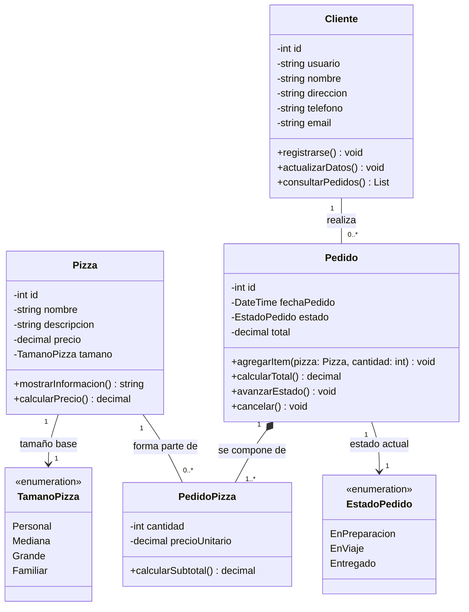
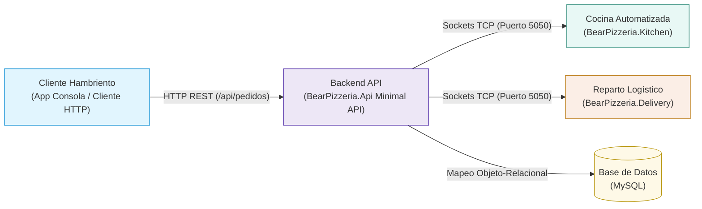
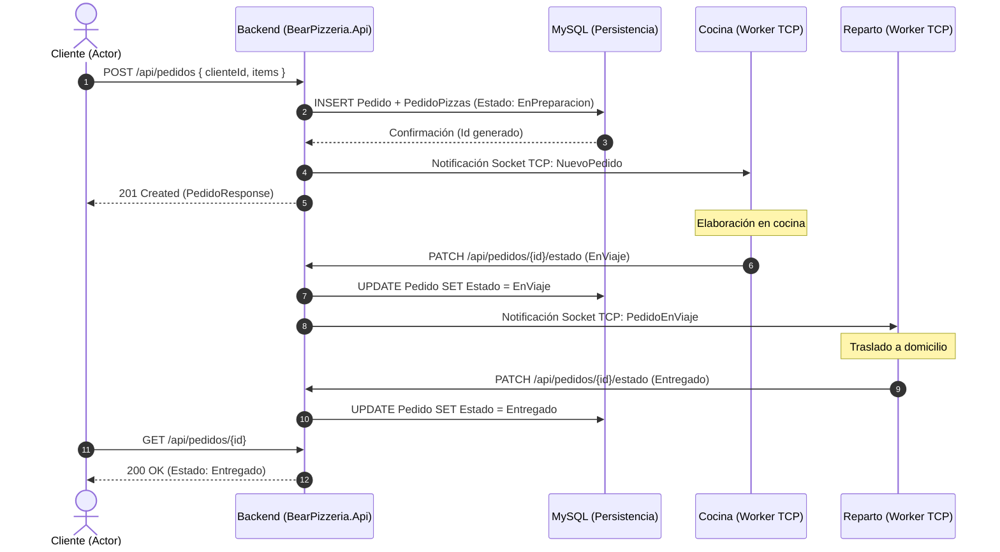

# Diagrama de Clases — BearPizzeria (Versión Rama: ProyectoPizzeria)

> [!NOTE]
> Este documento representa la **estructura estática inicial** del sistema correspondiente a la rama **`ProyectoPizzeria`** (modelo CRUD previo a la incorporación de autenticación JWT y carrito de compras).
> Ha sido normalizado y adaptado respetando rigurosamente las pautas pedagógicas del apunte **`Desarrollo de Sistemas - 6.º Año · Diagrama de Clases UML`**:
> 1. Derivación del modelo desde los Casos de Uso hacia las clases estructurales.
> 2. Representación de los tres compartimentos por clase (*Nombre*, *Atributos con tipo y visibilidad privada `-`*, *Métodos / Responsabilidades públicas `+`*).
> 3. Eliminación de claves foráneas como atributos primitivos (representadas exclusivamente mediante relaciones).
> 4. Justificación de la clase asociativa `PedidoPizza`.
> 5. Especificación formal de multiplicidades (`1`, `0..*`, `1..*`) y relaciones de composición (`*--`).
> 6. Separación estricta entre el **Modelo de Clases del Dominio** y los artefactos de infraestructura/base de datos.

---

## 1. Del Caso de Uso a las Clases del Dominio

Siguiendo el análisis planteado en el apunte:
* **Un Caso de Uso no se convierte en una clase ni automáticamente en un método único**: el caso de uso representa un objetivo completo del actor que requiere la colaboración de múltiples elementos estructurales.
* **No todo sustantivo es una clase**: se identifican las entidades representativas del negocio sobre las cuales el sistema necesita conservar datos y asignar responsabilidades.

### Modelo inicial de clases y responsabilidades (Alcance `ProyectoPizzeria`)

| Clase / Enumeración | Información que conserva (Atributos `-`) | Responsabilidades / Operaciones (`+`) |
| :--- | :--- | :--- |
| **`Cliente`** | `- id: int` `- usuario: string` `- nombre: string` `- direccion: string` `- telefono: string` `- email: string` | `+ registrarse(): void` `+ actualizarDatos(): void` `+ consultarPedidos(): List` |
| **`Pizza`** | `- id: int` `- nombre: string` `- descripcion: string` `- precio: decimal` `- tamano: TamanoPizza` | `+ mostrarInformacion(): string` `+ calcularPrecio(): decimal` |
| **`Pedido`** | `- id: int` `- fechaPedido: DateTime` `- estado: EstadoPedido` `- total: decimal` | `+ agregarItem(pizza: Pizza, cantidad: int): void` `+ calcularTotal(): decimal` `+ avanzarEstado(): void` `+ cancelar(): void` |
| **`PedidoPizza`** | `- cantidad: int` `- precioUnitario: decimal` | `+ calcularSubtotal(): decimal` |
| **`TamanoPizza`** | `<<enumeration>>` `Personal`, `Mediana`, `Grande`, `Familiar` | Define las variantes físicas de porción ofrecidas por cada pizza en el catálogo base. |
| **`EstadoPedido`** | `<<enumeration>>` `EnPreparacion`, `EnViaje`, `Entregado` | Representa el ciclo logístico del pedido a través de Cocina y Reparto. |

---

## 2. ¿Por qué `PedidoPizza` es una clase?

*(Aplicación directa de la Sección 8 del apunte didáctico)*

Relacionar directamente `Pedido` con `Pizza` mediante una simple línea asociativa impediría conservar información propia que surge únicamente en el instante en que una pizza forma parte de una orden:
* **Cantidad** solicitada de esa pizza.
* **Precio unitario histórico** (congelado al momento de emitir el pedido, para que futuros cambios de precio en el catálogo no alteren pedidos ya facturados).
* **Subtotal** de esa línea de compra.

Al poseer atributos y comportamiento propio (`calcularSubtotal()`), `PedidoPizza` deja de ser una simple línea de asociación y pasa a ser modelada como un **elemento de primera clase en el dominio** (clase asociativa / detalle).

---

## 3. Diagrama de Clases UML del Dominio

### Justificación de Relaciones y Multiplicidades:
* **`Cliente (1) -- Pedido (0..*)`**: Un cliente puede haber realizado ninguno o muchos pedidos a lo largo del tiempo; todo pedido pertenece exactamente a un único cliente.
* **`Pedido (1) *-- PedidoPizza (1..*)`**: Relación de **composición estricta** (`*--`). Un pedido se compone obligatoriamente de al menos una línea de detalle de pizza. Las instancias de `PedidoPizza` no poseen existencia independiente: si se destruye o cancela el pedido cabecera, se destruyen sus líneas de detalle.
* **`Pizza (1) -- PedidoPizza (0..*)`**: Cada línea de detalle referencia a una pizza específica del catálogo; una pizza puede estar presente en ninguno o muchos pedidos.
* **Dependencias de tipos enumerados (`--> 1`)**: `Pedido` y `Pizza` utilizan `EstadoPedido` y `TamanoPizza` como valores acotados de dominio.

---

## 4. Arquitectura Distribuida del Sistema

*(Capa de subsistemas y comunicación técnica de la rama `ProyectoPizzeria`)*

---

## 5. Diagrama de Secuencia — Flujo de Procesamiento de Pedido

